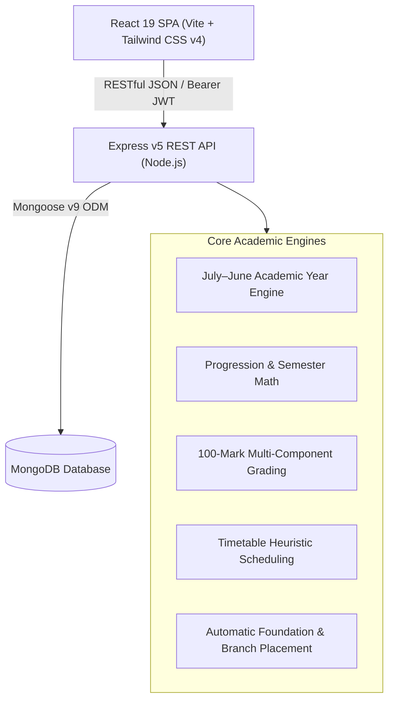

# RBPU Hub

**RBPU Hub** is an enterprise-grade university portal and ERP engineered for managing academic operations, attendance, multi-component grading, schedules, student services, and departmental administration in one unified system.

Built with a decoupled architecture pairing a **React 19** frontend with an **Express v5** and **MongoDB** RESTful API, RBPU Hub features specialized workspaces for **Superadmins**, **Teachers**, and **Students**.

---

## 1. System Architecture



For complete technical specifications, refer to [Architecture Documentation](docs/ARCHITECTURE.md).

---

## 2. Core Capabilities by Role

### 👑 Superadmin Workspace
- **Departmental Governance:** Create and manage university departments, appoint Heads of Departments (HODs), and monitor faculties.
- **Academic Setup:** Configure semester-specific classes (Semesters 1–8), assign Class Incharges, and manage courses/curriculum.
- **User Management & Bulk Onboarding:** Maintain faculty and student accounts with filtering, account suspension, password resets, and high-throughput CSV bulk import (up to 500 students per batch).
- **Marks Override & Historical Entry:** Record and update examination results across any program semester, including inactive students and alumni.
- **Student Services & Fees:** Manage 8-semester fee ledgers (Academic, Exam, Hostel, Transport), assign rooms across 4 university hostels, and track payments.
- **Timetable Generation:** Heuristic schedule generator matching teacher availability, room capacity/types (Labs vs. Classrooms), and university period configs with clash detection.
- **Broadcast Notices & Events:** Publish university-wide or department/class-scoped announcements and maintain the institutional event calendar.

### 👨‍🏫 Teacher Workspace
- **Teaching Dashboard:** Real-time view of assigned classes, allocated subjects, and aggregate student enrollments.
- **Attendance Tracking:** Mark lecture-by-lecture attendance with single-click present/absent toggling. Re-open and edit past lecture attendances for assigned cohorts.
- **Continuous Evaluation & Marks Entry:** Enter and update scores for MST 1, MST 2, 3 continuous assignments, attendance marks, and final exam marks against the university 100-mark formula.
- **Personal Timetable:** View weekly personal schedule across lecture periods, days, and room locations.
- **Announcements & Calendar:** Access institutional updates and relevant departmental events.

### 🎓 Student Workspace
- **Student Profile & Progress:** View matriculation year, automatically calculated semester, and roll number. Update contact details, blood group, address, and parent contacts.
- **Attendance Sheet & Shortage Alerts:** Live subject-by-subject attendance percentages with threshold shortage warnings (< 75%) and a complete historical log.
- **Academic Results & Marksheet:** View transparent grade sheets showing rounded-up MST averages, assignment averages, attendance points, final exam scores, and pass/fail indicators.
- **Schedule & Class Timetable:** View class weekly timetable and room allocations.
- **Student Services & Fee Ledger:** Check personal 8-semester fee breakdowns, payments recorded, and hostel/room assignments.

---

## 3. Technology Stack

| Layer | Technologies |
| :--- | :--- |
| **Frontend Client** | React 19, Vite, React Router v7, Tailwind CSS v4, Motion, Recharts, Axios, React Hot Toast |
| **Backend API** | Node.js, Express v5, Mongoose v9, JSON Web Tokens (JWT), bcryptjs, express-validator, Multer |
| **Database** | MongoDB (Document Store with compound unique indexing) |
| **Testing & Quality** | Native Node.js Test Runner (`node --test`), Oxlint |

---

## 4. Repository Layout

```text
├── client/                     # React 19 Single Page Application
│   ├── src/
│   │   ├── components/         # UI library & dashboard layouts
│   │   ├── context/            # AuthContext & Session management
│   │   ├── pages/              # 20+ feature pages & role dashboards
│   │   ├── services/           # Axios API service
│   │   └── utils/              # Client-side formatters
│   ├── README.md               # Client documentation
│   └── package.json
├── server/                     # Express v5 REST API
│   ├── config/                 # Database connection
│   ├── controllers/            # 11 Domain controllers
│   ├── middleware/             # JWT authentication & RBAC guards
│   ├── models/                 # 12 Mongoose data schemas
│   ├── routes/                 # Express route declarations & validators
│   ├── scripts/                # Database seeding & migration scripts
│   ├── utils/                  # Domain math & academic logic
│   ├── README.md               # Server documentation
│   └── package.json
├── docs/                       # Complete in-depth project documentation
│   ├── ACADEMIC_DOMAIN_LOGIC.md # University calendar, math, and grading rules
│   ├── API_REFERENCE.md        # Full REST API endpoint reference
│   ├── ARCHITECTURE.md         # System design, ERD, and sequence flows
│   └── SECURITY_AND_DEPLOYMENT.md # Hardening, Docker, and deployment guide
└── README.md                   # Repository entry point
```

---

## 5. Quickstart Guide

### Prerequisites
- Node.js (v18.0.0 or higher)
- MongoDB instance (local or MongoDB Atlas connection string)

### 1. Server Configuration
```bash
cd server
cp .env.example .env
```
Update `server/.env` with your `MONGO_URI`, `JWT_SECRET`, and initial `SUPERADMIN_*` credentials.

### 2. Install Server Dependencies & Seed Database
```bash
npm install
npm run seed
```
*The seed command bootstraps the initial superadmin account configured in `.env` if not already present.*

### 3. Run Backend Server
```bash
npm run dev
```
*API defaults to `http://localhost:5000`.*

### 4. Client Configuration & Startup
In a separate terminal:
```bash
cd client
cp .env.example .env
npm install
npm run dev
```
*Client defaults to `http://localhost:5173`.*

---

## 6. Available Scripts

| Directory | Command | Description |
| :--- | :--- | :--- |
| `server` | `npm run dev` | Start the backend API with auto-reload (Nodemon) |
| `server` | `npm start` | Start the backend API in production mode |
| `server` | `npm test` | Run the backend unit test suite (`node --test`) |
| `server` | `npm run seed` | Bootstrap the initial superadmin account |
| `client` | `npm run dev` | Start the Vite development server with HMR |
| `client` | `npm run build` | Compile and bundle production assets in `client/dist/` |
| `client` | `npm run preview`| Locally preview the production client build |
| `client` | `npm run lint` | Execute static linting with Oxlint |

---

## 7. Academic Business Rules Summary

- **Academic Year Cycle:** Evaluated in `Asia/Kolkata`. July–December corresponds to the starting year (`YYYY-YY+1`); January–June continues the cycle.
- **Progression Math:** Calculated semester begins August 1st of student's matriculation year (`startingYear`), advancing in January and July. Term > 8 marks status as `alumni`.
- **First-Year Foundation:** Students in Semesters 1 and 2 are administratively housed in the **Applied Sciences (`AS`)** department. Foundation courses generated in AS automatically link across peer classes via `sharedGroupId`. Students transition to their degree department (`CSE`, `IT`, `ME`, `CE`) in Semester 3.
- **100-Mark Formula:**
  - $\text{MST Average (2 tests, max 24)}$ + $\text{Assignment Average (3 tests, max 10)}$ + $\text{Attendance (max 6)}$ + $\text{Final Exam (max 60)}$ $= 100 \text{ marks}$.
  - Intermediate averages are rounded up to whole numbers.
- **Semester Fees:** Base tuition is ₹40,000 + ₹1,500 exam fee per semester. Hostel residents pay an additional ₹20,000/sem, and university transport commuters pay an additional ₹15,000/sem.

For detailed domain formulas, see [Academic Domain Logic Guide](docs/ACADEMIC_DOMAIN_LOGIC.md).

---

## 8. In-Depth Documentation

- 📐 **[System Architecture & Design](docs/ARCHITECTURE.md)**: Detailed component interactions, data layer ERD, and state lifecycle.
- 📡 **[REST API Reference](docs/API_REFERENCE.md)**: Comprehensive specification of all endpoints, parameters, and payloads.
- 🎓 **[Academic Domain Logic](docs/ACADEMIC_DOMAIN_LOGIC.md)**: Calculation formulas, semester math, and evaluation schemes.
- 🔒 **[Security & Deployment Guide](docs/SECURITY_AND_DEPLOYMENT.md)**: Hardening checklist, reverse proxy setup, and production configurations.
- 🖥️ **[Server Guide](server/README.md)**: Backend layout and controllers reference.
- 💻 **[Client Guide](client/README.md)**: Frontend architecture and UI component catalog.
