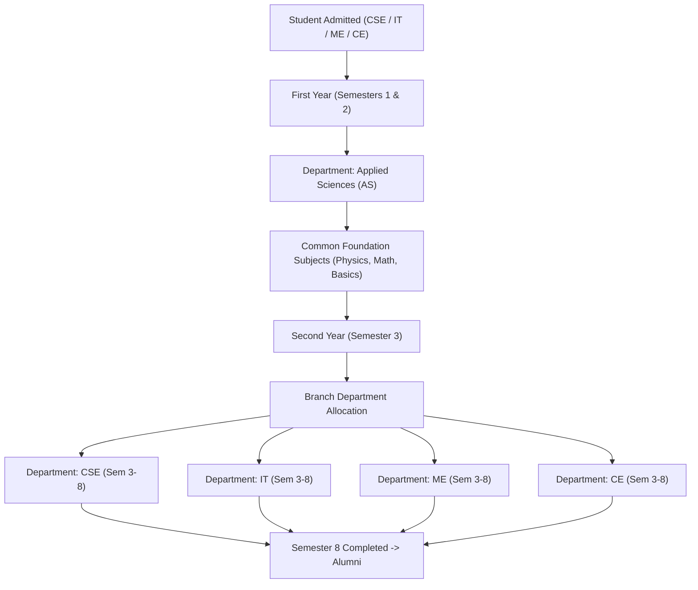

# Academic Operations & Domain Business Logic

RBPU Hub implements domain logic aligned with Indian university statutory norms and semester systems. This document outlines the mathematical models, placement rules, grading schemes, and financial accounting logic.

---

## 1. Academic Year Calculation Engine

The academic year runs on a **July to June** cycle evaluated in Indian Standard Time (`Asia/Kolkata`).

### Algorithm
```text
Given: Local Date (year, month) where month is 1-indexed (1 = January, 12 = December)

If month >= 7 (July through December):
    startYear = year
Else (January through June):
    startYear = year - 1

AcademicYear = startYear + "-" + (startYear + 1).slice(-2)
```

### Examples
| Calendar Date | Calculated Academic Year | Term Classification |
| :--- | :--- | :--- |
| **August 2026** | `2026-27` | Odd Semester Start |
| **November 2026** | `2026-27` | Odd Semester Midterm / Final |
| **January 2027** | `2026-27` | Even Semester Start |
| **May 2027** | `2026-27` | Even Semester Exams |
| **July 2027** | `2027-28` | New Academic Year Transition |

*Implementation: `server/utils/academicYear.js`*

---

## 2. Student Progression & Semester Math

A student's academic standing is derived mathematically from their matriculation year (`startingYear`).

### Progression Model
- **Semester 1 Start:** August 1st of `startingYear`.
- **Term Number Formula:**
  $$\text{Term} = 2 \times (\text{Current Year} - \text{Starting Year}) + (\text{Current Month} \ge 6 \; ? \; 1 : 0)$$
  *(where month is 0-indexed: 6 corresponds to July).*
- **Semester Cycles:**
  - **Odd Semesters (1, 3, 5, 7):** Active from July through December.
  - **Even Semesters (2, 4, 6, 8):** Active from January through June.
- **Alumni Classification:** When $\text{Term} > 8$, the student's status automatically transitions to `alumni`, locking their final completed semester at 8.

### Lifecycle Matrix
| Starting Year | As of Nov 2026 (Month 11) | Current Semester | Academic Status |
| :---: | :---: | :---: | :---: |
| **2026** | $2 \times 0 + 1 = 1$ | Semester 1 | Studying |
| **2025** | $2 \times 1 + 1 = 3$ | Semester 3 | Studying |
| **2024** | $2 \times 2 + 1 = 5$ | Semester 5 | Studying |
| **2023** | $2 \times 3 + 1 = 7$ | Semester 7 | Studying |
| **2022** | $2 \times 4 + 1 = 9$ | None (Passed Sem 8 in June 2026) | **Alumni** |

*Implementation: `server/utils/studentAcademic.js`*

---

## 3. Department Placement & Foundation Years

In accordance with engineering curriculum structures, all students undergo a common foundation curriculum during their first year.



### Placement Rules
1. **Semesters 1 & 2:** Placed in the **Applied Sciences (`AS`)** department. Class name corresponds to their program, but the administrative department is `AS`.
2. **Semesters 3 through 8:** Placed in their respective degree department (`CSE`, `IT`, `ME`, `CE`).
3. **Alumni:** Remain mapped to Semester 8 of their degree department.

### Shared Foundation Courses (`sharedGroupId`)
When a course is added to Applied Sciences for Semester 1 or Semester 2:
- The system checks all peer classes in Applied Sciences for that semester.
- A single subject definition generates linked instances across all branch cohorts sharing a unique `sharedGroupId`.
- Editing syllabus, periods, or teachers automatically synchronizes across all linked cohorts.

*Implementation: `server/utils/studentPlacement.js` and `server/controllers/subjectController.js`*

---

## 4. The 100-Mark Evaluation Scheme

The university employs a standardized 100-mark evaluation formula across all subjects.

### Assessment Component Breakdown

| Category | Component Name | Count | Component Max | Category Max | Group Key |
| :--- | :--- | :---: | :---: | :---: | :---: |
| **Mid-Semester Tests (MST)** | MST 1, MST 2 | 2 | 24 each | **24 Marks** | `mst` |
| **Continuous Assignments** | Assignment 1, 2, 3 | 3 | 10 each | **10 Marks** | `assignment` |
| **Attendance Weightage** | Attendance | 1 | 6 | **6 Marks** | `attendance` |
| **End-Semester Examination** | Final Exam | 1 | 60 | **60 Marks** | `final` |
| **Total Marks Possible** | — | **7** | — | **100 Marks** | — |

### Rounding & Aggregation Formula
1. **MST Average:**
   $$\text{MST Score} = \left\lceil \frac{\text{MST}_1 + \text{MST}_2}{2} \right\rceil \le 24$$
2. **Assignment Average:**
   $$\text{Assignment Score} = \left\lceil \frac{\text{Assn}_1 + \text{Assn}_2 + \text{Assn}_3}{3} \right\rceil \le 10$$
3. **Attendance Score:**
   $$\text{Attendance Score} = \lceil \text{Attendance} \rceil \le 6$$
4. **Final Exam Score:**
   $$\text{Final Score} = \lceil \text{Final Exam} \rceil \le 60$$
5. **Subject Total:**
   $$\text{Total} = \text{MST Score} + \text{Assignment Score} + \text{Attendance Score} + \text{Final Score}$$
6. **Pass / Fail Determination:**
   $$\text{Result} = \begin{cases} 
   \text{"pass"} & \text{if } \text{Total} \ge \text{passingPercentage (default 40%)} \\ 
   \text{"fail"} & \text{if } \text{Total} < \text{passingPercentage} \\
   \text{"incomplete"} & \text{if any required component is missing} 
   \end{cases}$$

*Implementation: `server/utils/calculations.js` and `server/utils/markingScheme.js`*

---

## 5. Student Services & Fee Accounting Ledger

Student accounts maintain a cumulative financial ledger covering all eight semesters of their degree.

### Standard Semester Assessments
Every semester assesses fees based on the student's operational usage:

| Fee Category | Condition | Rate per Semester |
| :--- | :--- | :---: |
| **Academic Tuition Fee** | Mandatory for all enrolled students | ₹40,000 |
| **University Examination Fee** | Mandatory for all enrolled students | ₹1,500 |
| **Hostel & Mess Fee** | Applicable if assigned to any of 4 hostels | ₹20,000 |
| **University Transport Fee** | Applicable if `usesTransport == true` | ₹15,000 |

### Fee Snapshot Preservation
When a student changes hostel status (e.g., moves out after Semester 2), past assessed fees remain fixed in `semesterFees[semester].assessedHostel` to preserve financial audit histories.

*Implementation: `server/utils/studentServices.js`*
