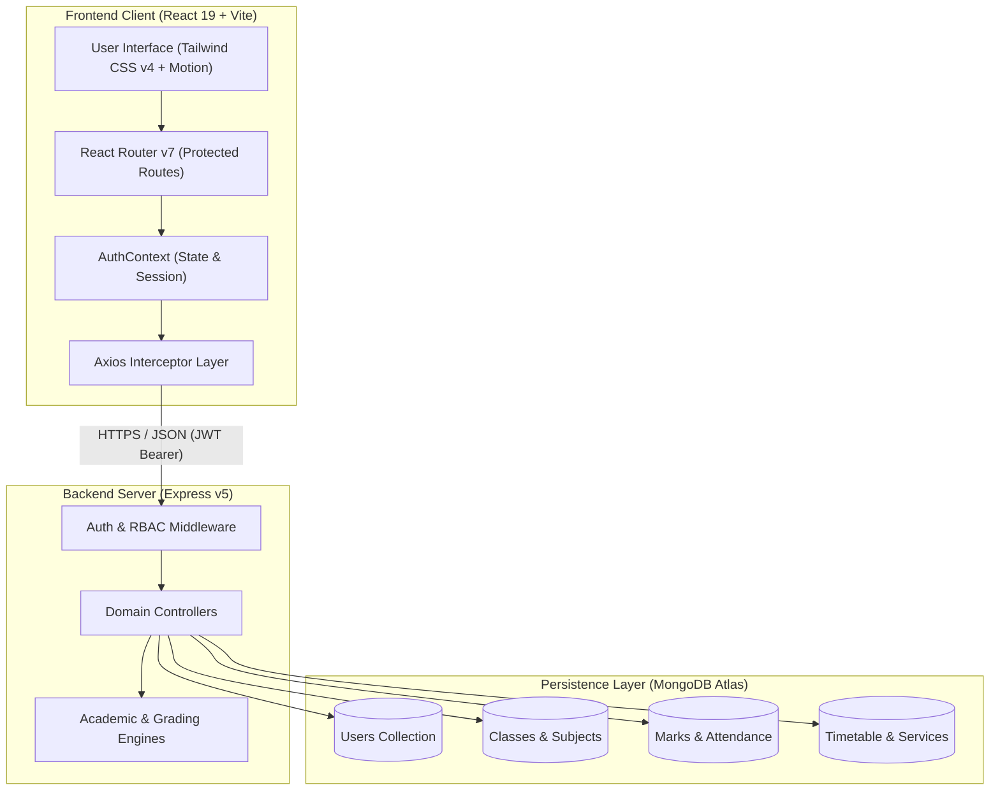
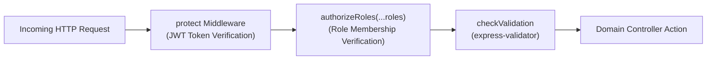
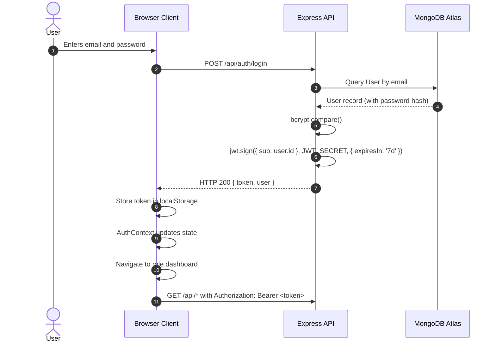

# System Architecture & Technical Design: RBPU Hub

RBPU Hub is an enterprise university management portal architected as a decoupled client-server web application. It enables centralized academic operations for administrators, faculty, and students across Rayat Bahra Professional University.

---

## 1. High-Level Architecture

The system operates on a classic three-tier architecture:
1. **Presentation Layer (Client):** A React 19 Single-Page Application (SPA) bundled with Vite, styled with Tailwind CSS v4, and accelerated by Motion for fluid state transitions.
2. **Application Layer (API Server):** A Node.js server powered by Express v5, implementing stateless JWT authentication, role-based authorization, request validation, and domain calculation engines.
3. **Data Layer (Database):** A MongoDB database interfaced via Mongoose v9 schemas, maintaining indexes, referential consistency, and automatic timestamps.



---

## 2. Entity-Relationship Model (Data Architecture)

The database schema reflects university relationships with referential integrity maintained through application-level checks and Mongoose ObjectId references.

```mermaid
erDiagram
    Department ||--o{ Class : "offers"
    Department ||--o{ Subject : "hosts"
    Department ||--o{ User : "employs / enrolls"
    Department ||--o| User : "headed by (HOD)"
    
    Class ||--o{ Subject : "has curriculum"
    Class ||--o{ User : "contains students"
    Class ||--o| User : "advised by (Incharge)"
    Class ||--o{ Attendance : "records"
    Class ||--o{ Marks : "assesses"
    Class ||--o{ Timetable : "scheduled in"

    User ||--o{ Attendance : "markedBy / editedBy"
    User ||--o{ Marks : "scored / enteredBy"
    User ||--o{ Subject : "taught by (Teacher)"
    User ||--o{ Timetable : "assigned (Teacher)"

    Subject ||--o{ Attendance : "tracked for"
    Subject ||--o{ Marks : "evaluated for"
    Subject ||--o{ Timetable : "allocated in"

    Room ||--o{ Timetable : "conducted in"
    Department ||--o{ Room : "located in"
```

### Collection Definitions

| Collection | Schema / Purpose | Key Indexes & Constraints |
| :--- | :--- | :--- |
| **User** | Accounts for superadmins, teachers, and students. Holds personal info, academic placement, and fee/hostel services. | `email` (unique). Select-false password field. |
| **Department** | Academic departments (e.g., Applied Sciences, CSE, IT, ME, CE). | `code` (unique, uppercase). Refers to HOD `User`. |
| **Class** | Semester-specific cohort (Semesters 1–8). Links department, semester, and academic year. | Compound lookup on `(department, semester, name)`. Refers to `advisor` (teacher). |
| **Subject** | Courses taught in a class. Holds weekly periods, room requirements, and foundation shared groups. | `sharedGroupId` index for foundation courses across branches. |
| **Attendance** | Lecture-wise attendance record containing student present/absent statuses. | Compound unique index: `{ class: 1, subject: 1, date: 1, lectureNo: 1 }`. |
| **Marks** | Multi-component academic assessment for a student in a subject and semester. | Compound unique index: `{ student: 1, subject: 1, semester: 1, academicYear: 1 }`. |
| **Timetable** | Periodic schedule slots tying class, subject, teacher, room, and day/period. | Lookup indexes on `classId`, `teacherId`, and `roomId`. |
| **Room** | Physical infrastructure (Classrooms, Computer Labs, Workshops). | `name` (unique). Attributes: `capacity`, `type`, `isAvailable`. |
| **Settings** | Single university-wide record defining passing percentage, attendance threshold, and grading formula. | Immutable unique key: `key: "university"`. |
| **TimetableConfiguration** | University schedule settings: working hours, lunch times, lecture durations, periods per day. | Immutable unique key: `key: "university"`. |
| **Announcement** | Broadcast updates scoped by university, department, or class. | Scoped by visibility and role. |
| **Event** | University calendar events (exams, holidays, workshops, deadlines). | Compound index: `{ date: 1, endDate: 1 }`. |

---

## 3. Role-Based Access Control (RBAC) Architecture

RBPU Hub enforces strict access controls via authorization middleware:



### RBAC Permission Matrix

| Capability / Resource | Superadmin | Teacher | Student |
| :--- | :---: | :---: | :---: |
| **University Settings & Grading Scheme** | Read / Write | Read Only | ❌ |
| **Department Setup & HOD Assignment** | Full CRUD | Scoped Read | ❌ |
| **Class & Semester Administration** | Full CRUD | Assigned Classes Only | Assigned Class Only |
| **Subject & Teacher Allocation** | Full CRUD | Assigned Subjects Only | Assigned Subjects Only |
| **Student & Teacher User Directory** | Full CRUD | ❌ | ❌ |
| **CSV Batch Student Onboarding** | Execute | ❌ | ❌ |
| **Student Fee & Hostel Ledger** | Manage Payments | ❌ | View Personal Only |
| **Mark Attendance** | ❌ | Assigned Subjects | ❌ |
| **Edit Attendance** | ❌ | Marker or Class Advisor | ❌ |
| **View Attendance** | ❌ | Class Incharge / Teacher | Personal Record Only |
| **Enter & Update Marks** | All Students | Assigned Subjects Only | ❌ |
| **View Report Cards / Marks** | Full Access | Assigned Classes / Subjects | Personal Record Only |
| **Timetable Setup & Heuristic Generator** | Configure & Generate | ❌ | ❌ |
| **View Timetable** | Full Schedule | Personal Schedule | Class Schedule |
| **Post Announcements** | Full Access | ❌ | ❌ |
| **View Announcements** | Full Access | Scoped Access | Personal / Scoped |
| **Manage Events Calendar** | Full CRUD | Scoped Read | Scoped Read |
| **Student Profile Update** | View Only | View Only | Update Personal Info |

---

## 4. Client-Side Architecture & Lifecycle

### Authentication State Lifecycle
The frontend manages user authentication using React Context (`client/src/context/AuthContext.jsx`):



### Route Protection Architecture
The application guards routes through `client/src/components/ProtectedRoute.jsx`:
- Checks authentication loading state.
- Unauthenticated requests are redirected to `/login` with location memory.
- Unauthorized roles are redirected to `/unauthorized`.
- Superadmins with `isFirstLogin: true` are directed to `/change-password`.
- Authorized users access `/dashboard/:role/*`.

---

## 5. Algorithmic Engines

### Heuristic Timetable Generation
Located in `server/controllers/timetableController.js`:
1. Loads the university period slot configuration (e.g. 7 periods, 50 mins each, 5 working days).
2. Pulls all subjects registered to the target class and their teacher assignments.
3. Retrieves all operational rooms filtered by equipment and lab suitability.
4. Performs clash-free allocation:
   $$\text{Slot Available} \iff \text{Teacher Free} \land \text{Class Free} \land \text{Room Free}$$
5. Batches valid schedule entries into MongoDB drafts.

### Academic Year Automatic Transition
Located in `server/utils/academicYear.js`:
Evaluates current date in `Asia/Kolkata`:
$$\text{AcademicYear}(m, y) = \begin{cases} 
y \text{-} (y+1) & \text{if } m \ge 7 \\ 
(y-1) \text{-} y & \text{if } m < 7 
\end{cases}$$
Classes and settings inherit this academic year automatically.
