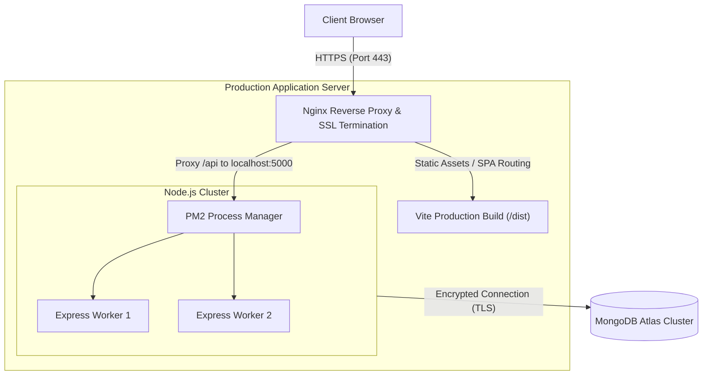

# Security Posture & Production Deployment Guide

This guide details the security analysis, hardening recommendations, and production deployment architecture for the **RBPU Hub** application.

---

## 1. Security Architecture & Threat Analysis

### A. Authentication & Secret Management
- **Password Hashing:** Passwords are encrypted using `bcryptjs` with a work factor of 12.
- **Length Limitation:** Inputs are capped at 72 bytes to prevent bcrypt CPU exhaustion attacks.
- **Exclusion on Query:** Passwords are excluded from Mongoose queries by default (`select: false`).
- **Token Format:** Stateless JSON Web Tokens (JWT) signed with HMAC-SHA256.

### B. Identified Security Gaps & Recommended Fixes

> [!CAUTION]
> **1. Absence of Rate Limiting (High Severity)**
> The authentication endpoints (`/api/auth/login`) currently lack rate-limiting middleware.
> - **Risk:** Susceptible to automated brute-force attacks and credential stuffing.
> - **Fix:** Install `express-rate-limit` and configure on auth routes:
>   ```javascript
>   const rateLimit = require('express-rate-limit')
>   const loginLimiter = rateLimit({
>     windowMs: 15 * 60 * 1000, // 15 minutes
>     max: 10, // 10 attempts
>     message: { message: 'Too many login attempts. Please try again later.' }
>   })
>   router.post('/login', loginLimiter, ...)
>   ```

> [!WARNING]
> **2. Insecure Token Storage in Client (Medium Severity)**
> Tokens are stored in browser `localStorage`, which is accessible to JavaScript if an XSS vulnerability occurs.
> - **Recommendation:** For maximum security, migrate JWT issuance to `HttpOnly`, `SameSite=Strict`, `Secure` cookies.

> [!NOTE]
> **3. Missing Security Headers (Medium Severity)**
> Missing HTTP security headers (CSP, HSTS, X-Frame-Options).
> - **Fix:** Add `helmet` in `server/index.js`:
>   ```javascript
>   const helmet = require('helmet')
>   app.use(helmet())
>   ```

---

## 2. Production Deployment Architecture



---

## 3. Deployment Checklist

### Step 1: Environment Hardening
Create production `.env` files with strong random keys:

**`server/.env`:**
```ini
PORT=5000
NODE_ENV=production
CLIENT_URL=https://portal.example.com
MONGO_URI=mongodb+srv://<db-user>:<db-password>@<cluster>.mongodb.net/<database>?retryWrites=true&w=majority
JWT_SECRET=<64-char-cryptographically-random-hex>
SUPERADMIN_EMAIL=admin@example.com
SUPERADMIN_PASSWORD=<strong-random-password>
```

**`client/.env`:**
```ini
VITE_API_URL=https://portal.example.com/api
```

### Step 2: Build Client
```bash
cd client
npm ci
npm run build
```
This generates the optimized production bundle in `client/dist/`.

### Step 3: Configure Process Manager (PM2)
In `server/ecosystem.config.js`:
```javascript
module.exports = {
  apps: [
    {
      name: 'rbpu-api',
      script: 'index.js',
      instances: 'max',
      exec_mode: 'cluster',
      env: {
        NODE_ENV: 'production',
        PORT: 5000,
      },
    },
  ],
}
```
Start the service:
```bash
cd server
npm ci --production
pm2 start ecosystem.config.js
pm2 save
```

### Step 4: Configure Nginx Reverse Proxy
```nginx
server {
    listen 80;
    server_name portal.rbpu.in;
    return 301 https://$host$request_uri;
}

server {
    listen 443 ssl http2;
    server_name portal.rbpu.in;

    ssl_certificate /etc/letsencrypt/live/portal.rbpu.in/fullchain.pem;
    ssl_certificate_key /etc/letsencrypt/live/portal.rbpu.in/privkey.pem;

    # Serve React Client Build
    root /var/www/rbpu-hub/client/dist;
    index index.html;

    location / {
        try_files $uri $uri/ /index.html;
    }

    # Proxy API Requests
    location /api/ {
        proxy_pass http://127.0.0.1:5000/api/;
        proxy_http_version 1.1;
        proxy_set_header Upgrade $http_upgrade;
        proxy_set_header Connection 'upgrade';
        proxy_set_header Host $host;
        proxy_set_header X-Real-IP $remote_addr;
        proxy_set_header X-Forwarded-For $proxy_add_x_forwarded_for;
        proxy_set_header X-Forwarded-Proto $scheme;
        proxy_cache_bypass $http_upgrade;
    }
}
```

---

## 4. Database Maintenance & Backup Policy

1. **Automated Daily Snapshots:** Enable continuous automated backups via MongoDB Atlas or daily cron using `mongodump`:
   ```bash
   mongodump --uri="$MONGO_URI" --gzip --archive=/backups/rbpu_$(date +%F).gz
   ```
2. **Index Optimization:** Ensure compound unique indexes are verified:
   ```javascript
   // Ensure indexes are built in production
   db.attendances.createIndex({ class: 1, subject: 1, date: 1, lectureNo: 1 }, { unique: true })
   db.marks.createIndex({ student: 1, subject: 1, semester: 1, academicYear: 1 }, { unique: true })
   db.users.createIndex({ role: 1, department: 1, class: 1 })
   ```
